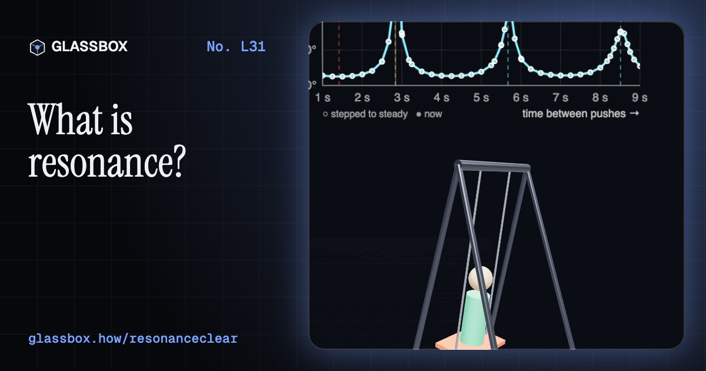
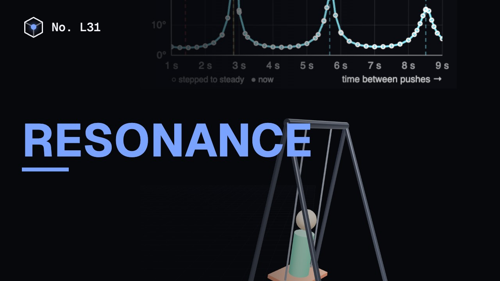
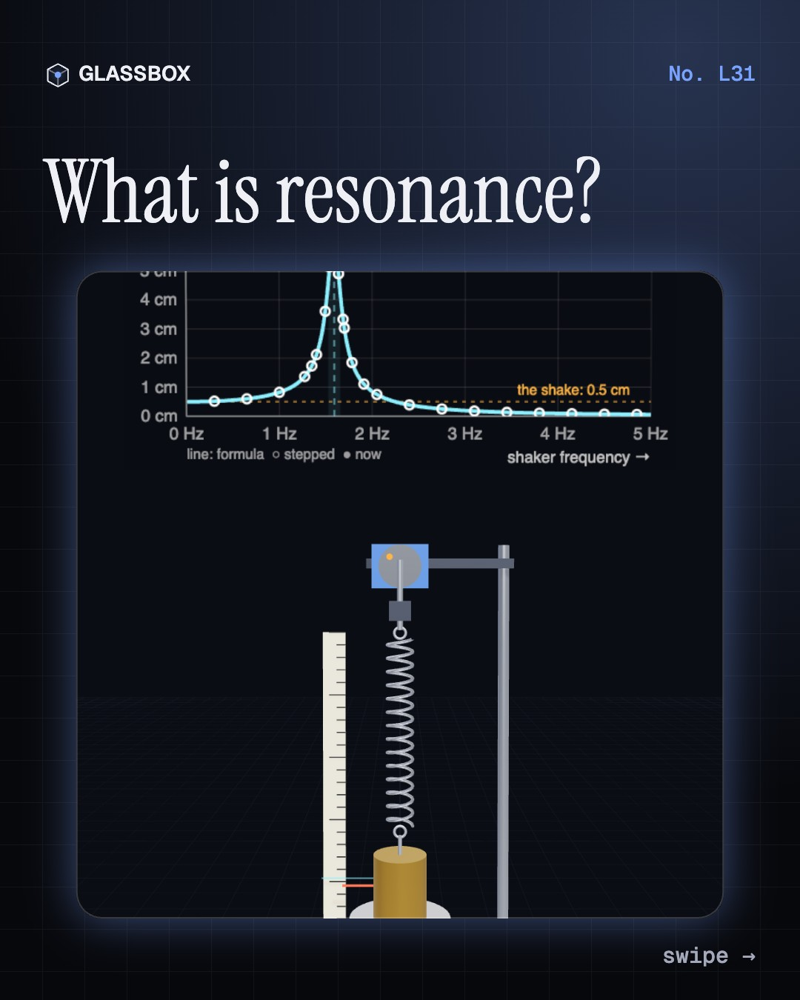
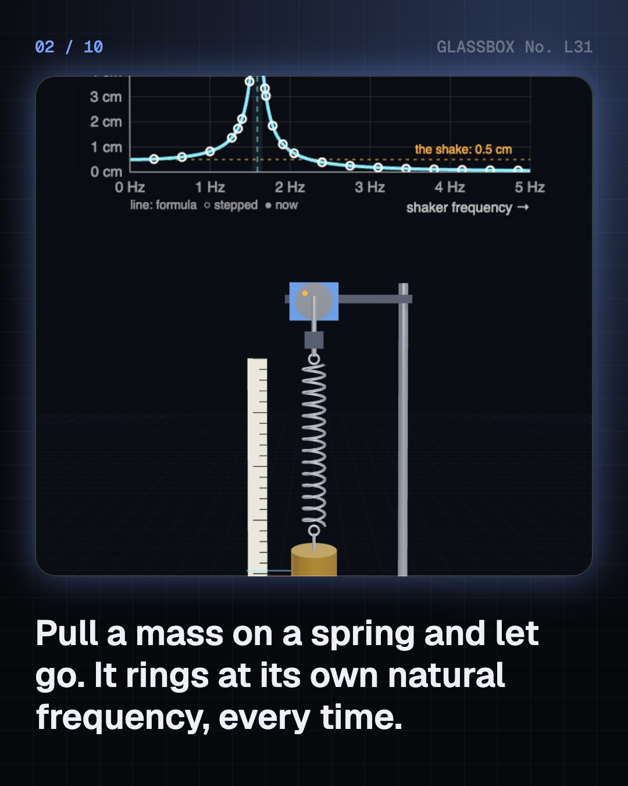
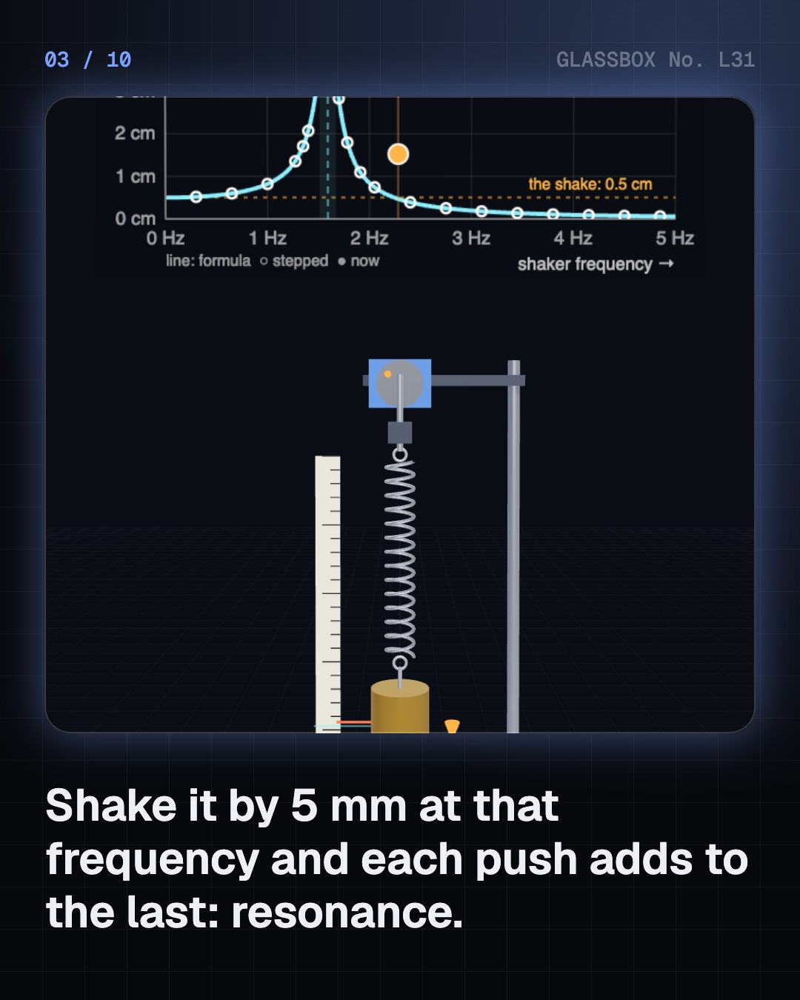
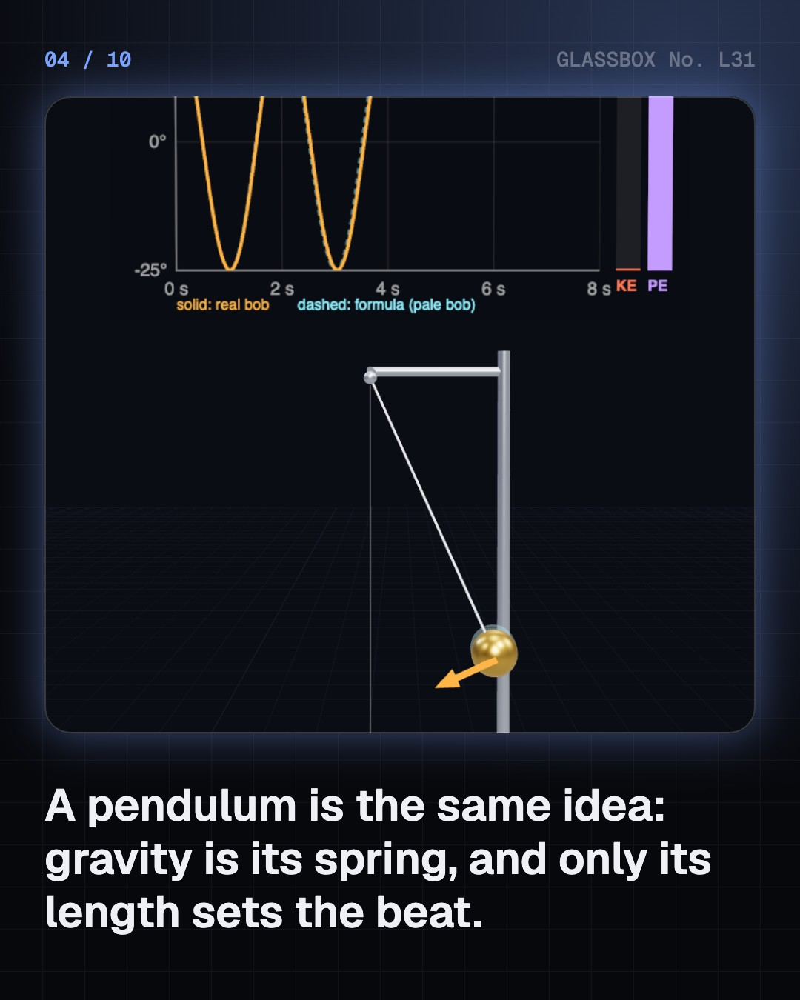

<!-- glassbox:start -->
<!-- Generated from glassbox.json by the Glassbox hub (npm run readme -- resonanceclear). Edit glassbox.json, not this block. -->
<p align="center"><a href="https://glassbox.how/e/resonanceclear/"></a></p>

<h1 align="center">Resonance</h1>

<p align="center"><b>What is resonance?</b><br>Push a swing in time and it flies. Shake a spring at its own beat and a 5 mm nudge becomes a 10 cm swing. Tune the shaker, wake a sitar's untouched strings, calm a skyscraper with a 660-tonne ball, and find out what really brought down the Tacoma Narrows Bridge.</p>

<p align="center"><a href="https://glassbox.how/resonanceclear/"><b>▶ Play with it</b></a> &nbsp;·&nbsp; <a href="https://glassbox.how/e/resonanceclear/">Read the 60-second explainer</a> &nbsp;·&nbsp; <a href="https://glassbox.how/resonanceclear/glassbox/reel.mp4">Watch the 40-second video</a></p>

<p align="center">
  <a href="https://glassbox.how/e/resonanceclear/"></a>
  <a href="https://glassbox.how/e/resonanceclear/"></a>
  <a href="LICENSE"></a>
  <a href="LICENSE-CONTENT.md"></a>
  <a href="#privacy"></a>
</p>

## In 60 seconds

1. **Everything has its own beat.** A mass on a spring bobs at one steady rate, T = 2π √(m ÷ k), whatever the size of the bob. Shake it at that natural frequency and each small push adds to the last. The swing builds to about Q times the push, where Q measures how little friction there is.
2. **A pendulum is a spring made of gravity.** Gravity pulls a pendulum back in proportion to how far it is pulled, so it keeps time like a spring: T = 2π √(L ÷ g), with the mass cancelling out. To get a swing high, push once per swing. Pushing twice per swing does nothing.
3. **Resonance picks one frequency.** A resonator ignores every rhythm but its own. A sitar's untouched strings ring only for their own note, a radio's coil and capacitor pass one station, and a watch's quartz crystal, with a Q near 100,000, holds 32,768 Hz to a few parts in a million.
4. **Buildings and bridges swing too.** A tower sways at about a tenth of a second per storey. A tuned mass damper, like Taipei 101's 660-tonne ball, swings against it and splits one tall peak into two low ones. London's Millennium Bridge swayed in 2000 because walkers fell into step with it.
5. **Three stories, checked.** Tacoma Narrows fell to flutter, a wind-fed twist, not to a matching rhythm. Microwave ovens are not tuned to water: it absorbs best near 20 GHz and ovens use 2.45 GHz to reach deeper. A voice can break a glass, but only just, and only a lucky glass.

## Words worth knowing

| Term | Meaning |
|---|---|
| **Simple harmonic motion** | The smooth to-and-fro of anything whose restoring force is proportional to its displacement. |
| **Natural frequency** | How often a system swings when left alone: (1 ÷ 2π) √(k ÷ m) for a mass on a spring. |
| **Period** | The time for one full swing: T = 2π √(m ÷ k) for a spring, 2π √(L ÷ g) for a pendulum. |
| **Damping** | Anything that takes energy out of a swing: friction, air drag, a shock absorber. |
| **Resonance** | The large response when something is pushed at, or very near, its natural frequency. |
| **Quality factor (Q)** | How lightly damped a resonator is: the swing at resonance is about Q times the push, and the peak is f₀ ÷ Q wide. |
| **Tuned mass damper** | A heavy mass tuned to a structure's own frequency that swings against it and soaks up its motion. |
| **Flutter** | A self-feeding vibration driven by a steady wind above a critical speed. It needs no matching rhythm, so it is not resonance. |

## A short history

**From a swinging lamp to a wobbling bridge: 400 years of things that answer their own rhythm.**

- **1602** · A pendulum keeps its own time (Galileo Galilei, Padua)
- **1638** · Small pushes, well timed (Galileo Galilei, Leiden (published), Arcetri)
- **1656** · The pendulum clock (Christiaan Huygens, The Hague)
- **1678** · Springs keep equal time (Robert Hooke, London)
- **1739** · Resonance appears on paper (Leonhard Euler, St Petersburg)
- **1831** · Soldiers bring down a bridge (74 men of the 60th Rifle Corps, Broughton, near Manchester)
- **1887** · A tuned loop catches radio waves (Heinrich Hertz, Karlsruhe)
- **1927** · A clock that runs on quartz (Warren Marrison and Joseph Horton, Bell Telephone Laboratories, New York)

The full story, with 20 moments, charts, people and 31 sources: [glassbox.how/e/resonanceclear/history](https://glassbox.how/e/resonanceclear/history/). The data lives in [`history.json`](history.json).

## Video and slides

Made with the Glassbox studio from this box's storyboard (`window.glassbox.director`). Free to reuse under CC BY 4.0.

<a href="https://glassbox.how/resonanceclear/glassbox/video.mp4"></a>

<p><a href="glassbox/slide-1.jpg"></a> <a href="glassbox/slide-2.jpg"></a> <a href="glassbox/slide-3.jpg"></a> <a href="glassbox/slide-4.jpg"></a></p>

| File | What | Size |
|---|---|---|
| [`glassbox/reel.mp4`](https://glassbox.how/resonanceclear/glassbox/reel.mp4) | Reel / Short, with captions and soundtrack | 1080×1920 |
| [`glassbox/video.mp4`](https://glassbox.how/resonanceclear/glassbox/video.mp4) | YouTube video, with captions and soundtrack | 1920×1080 |
| `glassbox/slide-1…10.jpg` | Instagram carousel | 1080×1350 |
| `glassbox/thumb.jpg` | YouTube thumbnail | 1280×720 |
| `glassbox/cover.jpg` | Share card and repo social preview | 1200×630 |
| [`glassbox/history-reel.mp4`](https://glassbox.how/resonanceclear/glassbox/history-reel.mp4) | “History in 10 moments” Reel / Short | 1080×1920 |
| `glassbox/history-slide-*.jpg` | History carousel | 1080×1350 |
| `glassbox/post.json` | Post copy and schedule used by the publish kit | |

## Privacy

This box has no accounts and no ads, and it ships its own fonts and libraries. When you run it yourself it sends nothing anywhere. On glassbox.how, the site's `/bar.js` also loads Glassbox's analytics: **Google Analytics** to count visits (it asks first in the EU, UK and Switzerland, and stays off when your browser sends Global Privacy Control or Do Not Track) and **ClickTrust** to detect bots.

It remembers a few things **in your own browser only**, and never sends them anywhere:

| Browser storage key | What it holds |
|---|---|
| `resonanceclear.v1` | Which chapters you have opened, your best quiz scores, and sound on or off. |

Exactly what each one sees is at [glassbox.how/privacy](https://glassbox.how/privacy/).

## Licences

- **Code:** [MIT](LICENSE). Use it, change it, ship it.
- **Explanations, text, images and videos** (`glassbox.json`, `glassbox/`): [CC BY 4.0](LICENSE-CONTENT.md). Credit “Glassbox, glassbox.how/e/resonanceclear”.
- **Third-party parts** keep their own licences: [three.js](https://threejs.org) (MIT), [Geist, Instrument Serif](https://openfontlicense.org) (SIL OFL 1.1).
- The Glassbox name and logo aren't covered by either licence. See the [terms](https://glassbox.how/terms/).

Found a mistake? [Open an issue](https://github.com/bdeeps/resonanceclear/issues). Corrections happen in public.
<!-- glassbox:end -->

## Run it

It's plain HTML, CSS and JavaScript. No build step and no dependencies. Run locally, it contacts no other website.

```bash
python3 -m http.server 8000
```

Three.js and the fonts ship in `vendor/` and `fonts/`, so it also works offline.

Then open http://localhost:8000.

## How it's built

| File | What |
|---|---|
| `index.html`, `css/app.css` | The page and its styles |
| `js/app.js`, `js/stage.js`, `js/ui.js`, `js/kit.js` | The shared Glassbox 3D engine: chapters, 3D stage, controls, quiz, video director |
| `js/reso.js` | ResonanceClear's own parts: the driven, damped oscillator stepped with RK4, the amplitude and phase meter, the analytic response, chart boards and the coil spring |
| `js/chapters/*.js` | One file per chapter: the 3D model, controls, text, key terms, quiz and video scenes |
| `glassbox.json` | Title, question, explainer beats, key terms, browser storage and credits shown on glassbox.how |
| `reel` in each chapter | The storyboard the Glassbox studio records into short videos |
| `glassbox/` | The published video, slides, thumbnail and post copy |
| `fonts/`, `vendor/three/` | Self-hosted Geist and Instrument Serif (SIL OFL 1.1) and three.js (MIT) |
